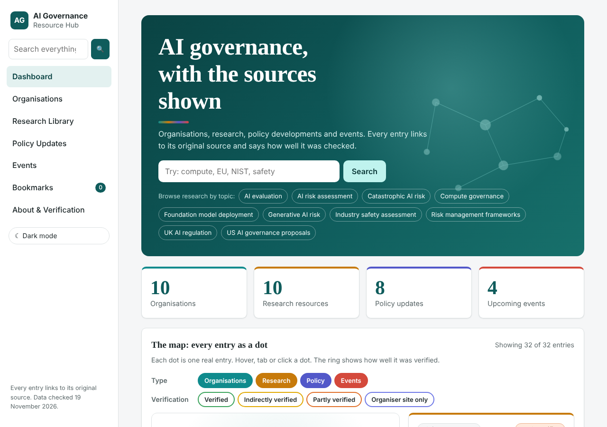
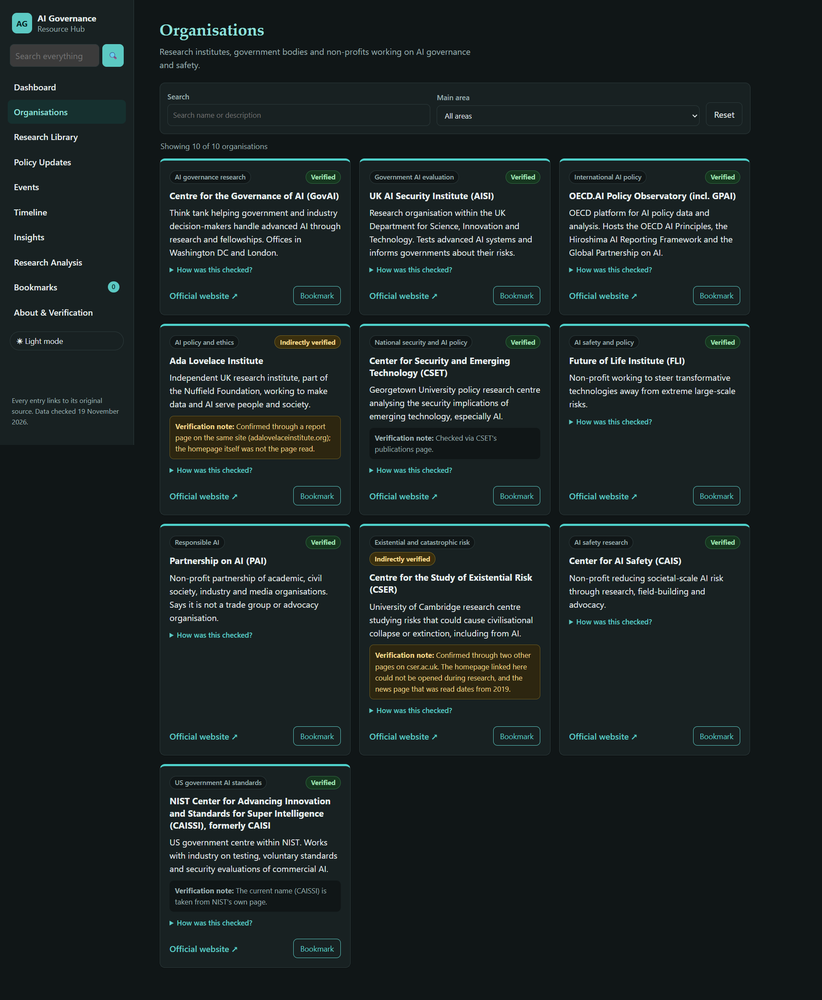
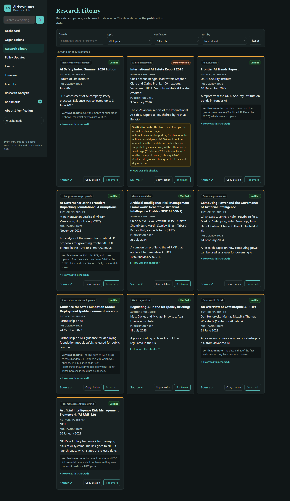
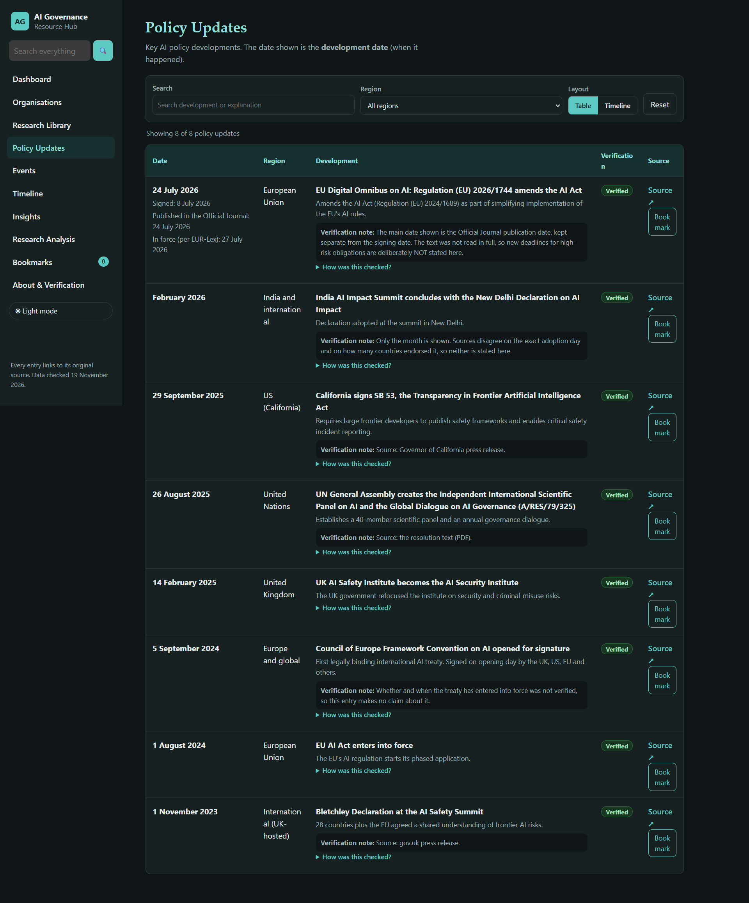
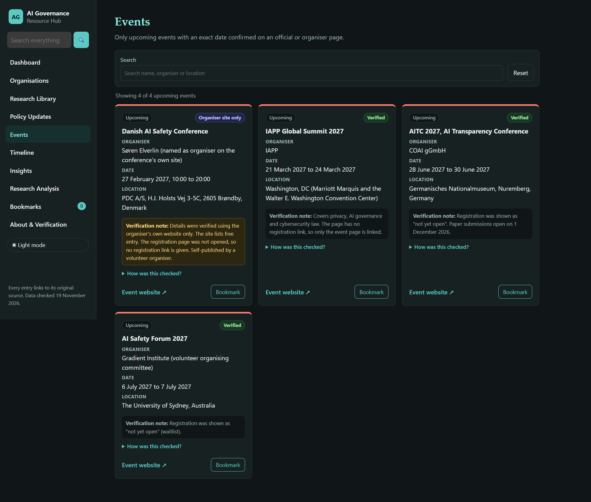
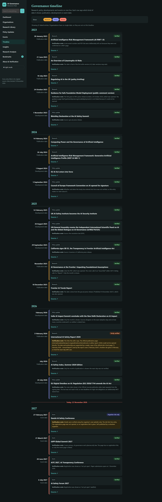
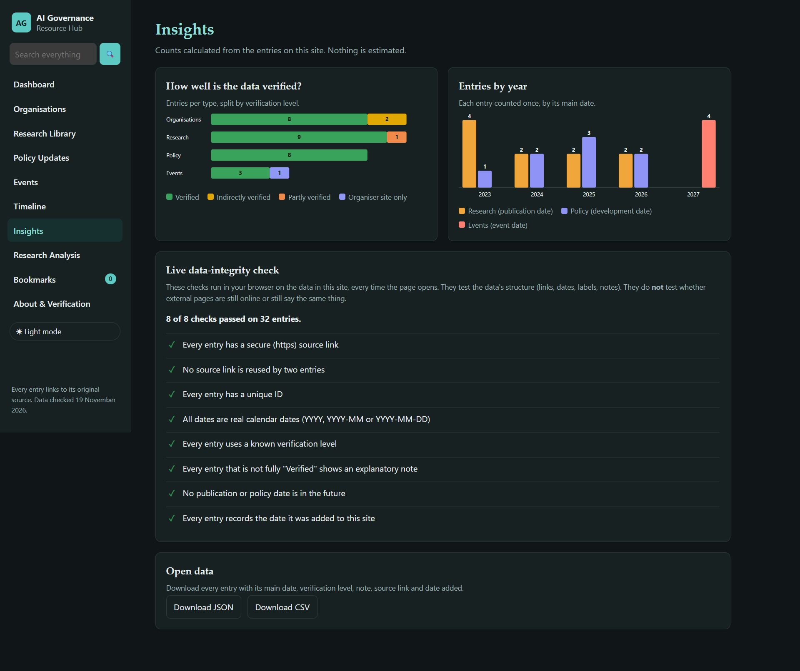
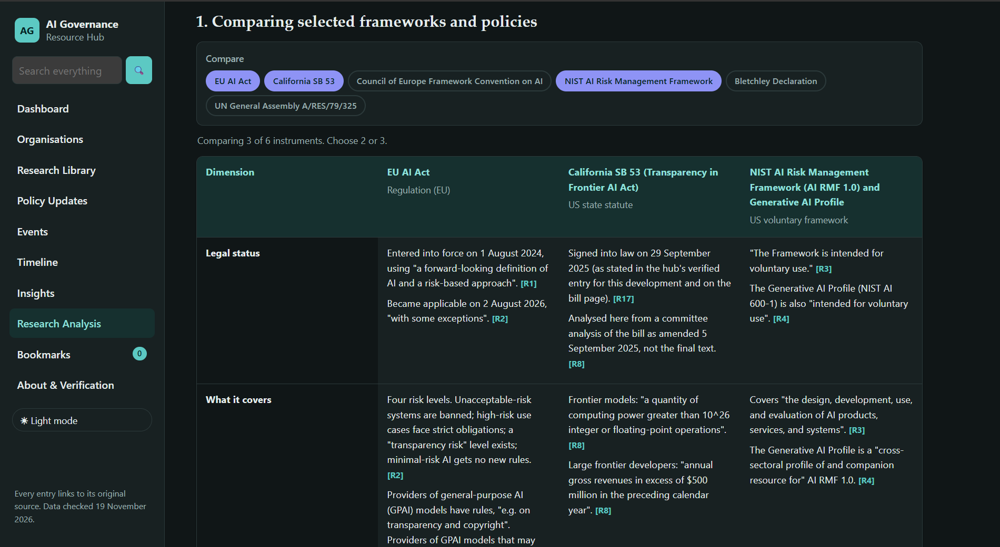
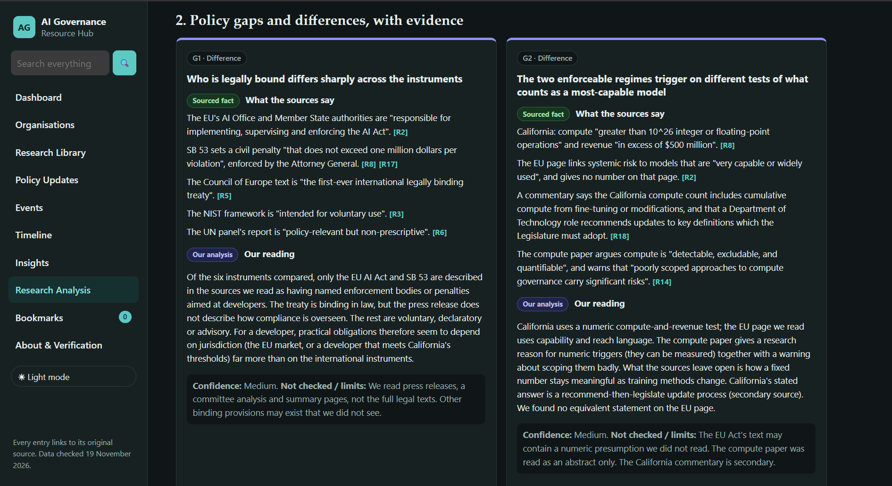

# AI Governance Resource Hub

A small, static website that collects source-linked, verification-labelled information about AI governance: organisations, research, policy developments and upcoming events. Built as a portfolio project and for an application to the GovAI UK Summer Fellowship 2027 (Applied Track).

**Live Website:** https://divyacodehub.github.io/ai-governance-resource-hub/

**GitHub Repository:** https://github.com/divyacodehub/ai-governance-resource-hub

## Features

- **Dashboard:** Overview of organisations, research resources, policy updates and upcoming events, with recently added entries, a verification summary and the GovAI fellowship opportunity.

- **Organisations:** Cards with descriptions, main areas of work and official links, with search and area filters.

- **Research Library:** Research publications with title, author/publisher, publication date, topic, summary and source link. Includes search, topic and verification filters, sorting and bookmarking.

- **Policy Updates:** Policy developments with dates, regions, explanations and source links, with table and chronological timeline views.

- **Events:** Displays upcoming events based on the visitor's local date. An honest empty state appears when no upcoming events remain.

- **Bookmarks:** Save entries in browser LocalStorage. Bookmarks survive page reloads and can be removed.

- **About & Verification:** Explains verification labels, known uncertainties and items deliberately left out.

- **Bookmark tools:** Download bookmarks as a TXT file with source links and verification labels, copy them, print them or remove all.

- **Global search:** Search organisations, research, policy and events together from the sidebar.

- **Shareable filtered views:** Filters are preserved in the URL, allowing filtered sections to be shared.

- **Dark mode:** Toggle between light and dark themes. The initial theme follows the device setting, and the user's choice is saved in LocalStorage.

- **Dashboard visual design:** Includes a dashboard hero, animated network graphic, quick search, topic shortcuts, count-up numbers and hover effects. Animations respect reduced-motion preferences.

- **Interactive Constellation Map:** Displays all 32 directory entries as SVG dots grouped by type: organisations, research, policy and events. Verification levels are represented visually. Supports previews, filtering and opening individual entries with source links and bookmark options.

- **Governance Timeline:** Displays dated research, policy developments and events on a chronological timeline grouped by year, with a Today marker. Each row identifies the type of date being shown. Month-only dates remain month-only.

- **Insights Dashboard:** Includes SVG charts showing entries by type and verification level, and entries by year and type.

- **Data Integrity Checker:** Eight structural checks run in the browser, covering HTTPS links, duplicate URLs, unique IDs, valid calendar dates, verification labels, verification notes, future publication/policy dates and the presence of `dateAdded`. These checks validate data structure, not external website availability.

- **Open Data Export:** Download all 32 directory entries as JSON or CSV, including titles, dates, verification information and source links.

- **Copy Citation:** Copy citation information from research items.

- **Research Analysis:** A dedicated page containing:
  1. An interactive side-by-side comparison of six AI governance instruments: EU AI Act, California SB 53, Council of Europe Framework Convention on AI, NIST AI Risk Management Framework, Bletchley Declaration and UN General Assembly A/RES/79/325.
  2. Six evidence-backed policy gaps and differences.
  3. Nine research findings with short quotations and references.
  4. Five practical policy recommendations.
  5. Methodology, limitations and an 18-item reference list.

  Statements distinguish between **Sourced fact** and **Our analysis**, with supporting references, confidence levels and limitations. Source silence is not treated as proof that a provision does not exist.

- **"How was this checked?" boxes:** Expandable verification information on directory cards, including status, research date, date added and linked source.

- **Print-friendly styling:** Sidebar and buttons are hidden when printing, while source URLs remain available.

- **Responsive layout:** The sidebar becomes a slide-in menu on mobile devices.

## Screenshots

### Dashboard


### Organisations


### Research Library


### Policy Updates


### Events


### Governance Timeline


### Insights


### Research Analysis




## Make it yours (before you share it)

Open `js/data.js` and fill in `PROJECT_INFO` (your name, a profile link such as LinkedIn or GitHub, and your repository URL). The dashboard then shows "Built by ...". Leave the values empty to hide the line. Do not change any factual data.

## Publish it for free (GitHub Pages)

1. Create a free GitHub account and a new public repository.
2. Upload the contents of this folder so that `index.html` is at the top level.
3. In the repository go to Settings, then Pages, choose the `main` branch and the root folder, and save.
4. After a minute GitHub shows your live link. Put that link and the repository URL in your application.

## Technologies

HTML, CSS and vanilla JavaScript only, plus browser LocalStorage and SVG. No frontend frameworks, build step, backend, database or paid API.

## How to run

1. Clone or download the repository.
2. Open the project folder.
3. Double-click `index.html` to open it in your browser.

Alternatively, run:

```bash
python3 -m http.server
```

Then visit `http://localhost:8000`. This also makes links to local documentation files work correctly.

## Data sources and verification approach

All content comes from `js/data.js`, with research and verification records documented in `docs/data-verification-log.md`. Every entry keeps its own `sourceUrl`, and sources are official or primary wherever possible. Descriptions are written in our own words.

Each entry carries one of four labels, shown on its card:

| Label | Meaning |
|---|---|
| Verified | The exact linked page was opened and read during research (19 November 2026). |
| Indirectly verified | A different page on the same official site confirms it (Ada Lovelace Institute, CSER). |
| Partly verified | Key facts are supported, but the official page could not be opened (International AI Safety Report 2026, linked via arXiv). |
| Organiser site only | Checked only on the organiser's own website (Danish AI Safety Conference). |

Uncertainties are shown on the website through card notes and the About page. Examples include month-only dates, the New Delhi Declaration's unspecified exact day or endorsement count, and policy details that could not be fully confirmed.

**What was not done:** Links were checked during research, not rechecked by the automated test suite, which had no web access. Web pages can change after 19 November 2026. Entries that could not be fully verified carry weaker labels rather than being presented as fully verified.

### Three kinds of date

- `publicationDate`: when a research resource was published.
- `developmentDate`: when a policy development happened.
- `dateAdded`: when an entry was added to this site (2026-11-19 for all original entries).

A value like `"2026-07"` means month only and is shown as "July 2026".

## Project structure (beginner-friendly)

```text
ai-governance-resource-hub/
│
├── index.html
│
├── css/
│   └── styles.css
│
├── js/
│   ├── data.js
│   ├── storage.js
│   ├── render.js
│   ├── analysis-data.js
│   ├── analysis.js
│   ├── insights.js
│   ├── constellation.js
│   └── app.js
│
├── docs/
│   ├── screenshots/
│   ├── data-verification-log.md
│   └── analysis-verification-log.md
│
└── README.md
```

Load order matters: `data.js` → `storage.js` → `render.js` → `constellation.js` → `insights.js` → `analysis-data.js` → `analysis.js` → `app.js`, because each file uses things defined by the previous ones.

**How it works:** The URL hash (`#research`) picks which section is visible. When a visitor searches or changes a filter, `app.js` filters the arrays from `data.js`, asks `render.js` for the HTML of each result and puts it on the page. Clicking Bookmark calls `toggleBookmark()` in `storage.js`, which saves a small list in LocalStorage, then the lists redraw.

**To add an entry:** Copy an existing object in `js/data.js`, change its fields, keep a real `sourceUrl`, set an honest `verification.level` and set `dateAdded`.

## Research Analysis: how it was made, and its limits

- Sources were opened on 22 November 2026 and read through a fetch tool that extracts page text. Quotations are as returned by the tool and were not rechecked character by character against the live pages.
- Full legal texts (EU AI Act, Regulation (EU) 2026/1744, the Council of Europe Convention and the final SB 53 text) were not all read in full. Therefore, the analysis makes no claims about EU fine amounts or the treaty's oversight mechanism. Several sources were read as abstracts only.
- SB 53 is described using a committee analysis of a pre-enactment amended version, a bill-page digest and secondary commentary. The final law may differ in detail.
- EU high-risk dates (Annex III "extended to 2 December 2027", Annex I "until 2 August 2028") come from a Commission webpage and were not checked against the full regulation text.
- UK findings come from a 2023 briefing. Current UK law was not checked, so that gap is rated Low confidence.
- The comparison is selective and describes what instruments say, not whether they work.
- **AI assistance disclosure:** This section was drafted with AI assistance. Claims and sources should be reviewed before presenting the analysis as independent original research.

Further details are available in `docs/analysis-verification-log.md`.

## Testing performed

The project records automated browser tests using Python Playwright and Chromium, run on 21 November 2026. The test scripts are not included in this folder.

The reported tests covered:

- Navigation to all views and dashboard counts.
- Search, filters, reset, empty states and sorting.
- Bookmark creation, removal, mixed types and persistence after reload.
- Month-only date display and policy date handling.
- Source-link attributes and consistency of every URL in `data.js` with the approved verification log.
- Console errors and a 375px mobile layout, including menu behaviour and horizontal scrolling.
- Research Analysis navigation, comparison controls, six gaps, nine findings, five recommendations and 18 references.
- Labels, citation clicks, section navigation, eight citation checks and detection of a deliberately broken reference.
- Contrast checks in light and dark themes and mobile layout.
- Timeline rendering, 22 rows, year ordering, Today marker and type toggles.
- Chart totals covering 32 entries and 22 dated entries.
- Eight integrity checks, including detection of deliberately broken test values.
- JSON and CSV downloads, with 32 entries.
- Citation copying.
- Interactive map behaviour, including 32 dots, four clusters, previews, click-to-open cards, bookmarks, filters and keyboard selection.
- Dark mode toggle, persistence and operating-system preference.
- Topic shortcuts, hero search, global search and URL-based filters.
- "How was this checked?" boxes, bookmark download/copy/remove-all tools and print stylesheet behaviour.

These are the tests reported in the project's existing documentation; the test scripts are not included in the repository.